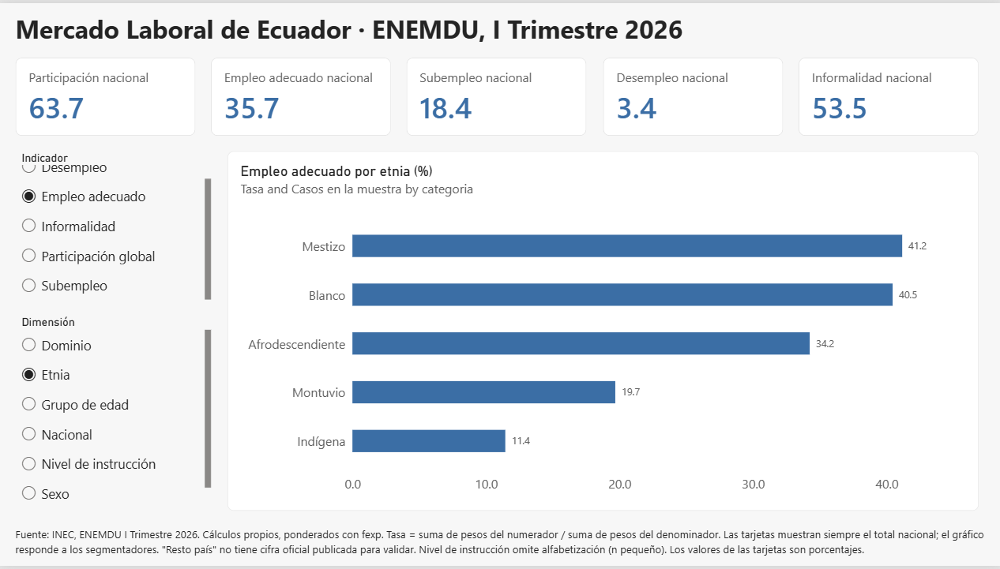
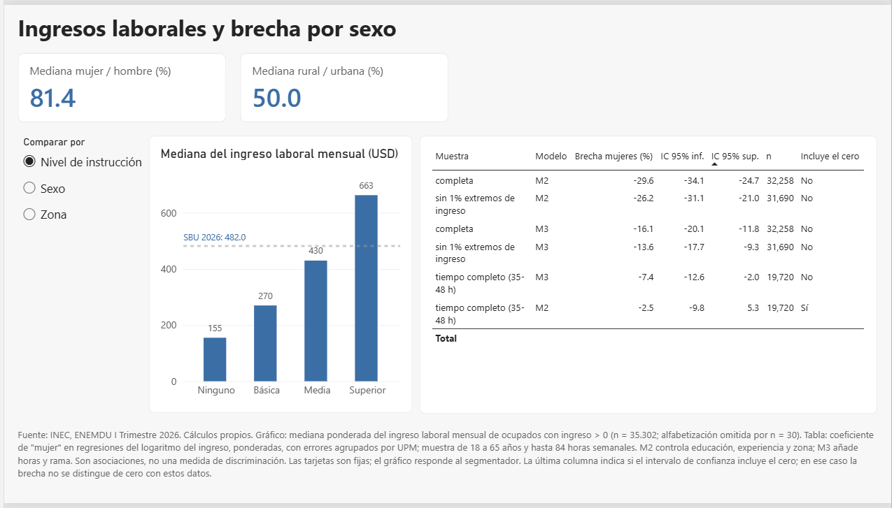
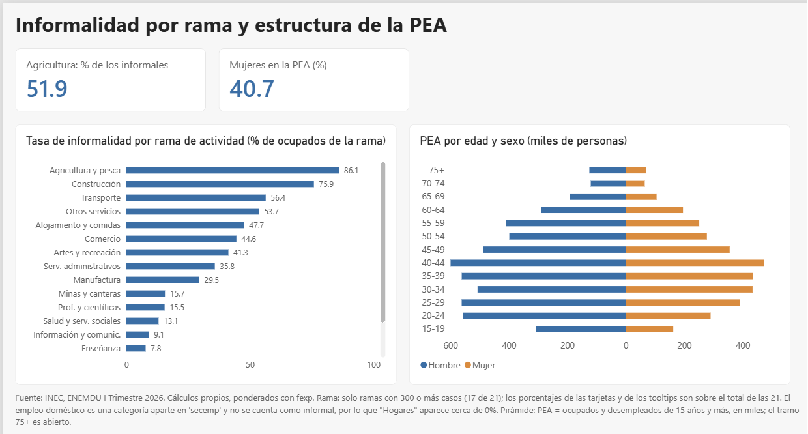

# Mercado laboral en Ecuador: ENEMDU I Trimestre 2026

Análisis de la Encuesta Nacional de Empleo, Desempleo y Subempleo (INEC) con pandas, SQL, regresión de Mincer y un tablero en Power BI.

**Estado:** completo (alcance mínimo). Informe de una página: [`reports/informe_ejecutivo.pdf`](reports/informe_ejecutivo.pdf).

## Resultados principales

- **El problema es la calidad del empleo, no el desempleo.** Desempleo 3,4 %, empleo adecuado 35,7 %, subempleo 18,4 %, otro empleo no pleno 32,6 %, no remunerado y no clasificado 9,9 %.
- **Brecha urbano-rural.** Desempleo rural 1,7 % y empleo adecuado rural 18,0 % (urbano 44,9 %).
- **Informalidad: 53,5 %** (urbana 41,7 %, rural 75,7 %). Agricultura: 32,3 % de los ocupados, 86,1 % informal, 51,9 % de todos los informales.
- **Educación.** Informalidad por instrucción: 90,0 / 74,6 / 48,3 / 19,6 %. Ingreso mediano: 155 / 270 / 430 / 663 USD (SBU 2026: 482).
- **Etnia.** Empleo adecuado: indígena 11,4 %, montuvio 19,7 %, afrodescendiente 34,2 %, blanco 40,5 %, mestizo 41,2 %. Coincide con la ruralidad (87,8 % de los indígenas vive en zona rural).
- **Brecha de ingresos de las mujeres.** Mediana 430 USD (hombres) y 350 (mujeres), razón 0,814. La brecha ajustada depende de muestra y controles (ver Mincer).

## Validación contra cifras oficiales

Antes de analizar se reprodujeron las cifras del INEC a nivel nacional, por dominio y la informalidad (53,5 %). La participación global difiere en una décima (63,7 % frente a 63,8 %); causa no identificada. Los cálculos en SQL reproducen los de pandas, y las tarjetas de Power BI reproducen ambos.

## Modelo de Mincer

Regresión de ln(ingreso) por mínimos cuadrados ponderados con `fexp`, errores agrupados por UPM. Porcentaje = 100·(e^β − 1). Intervalos de confianza al 95 %.

| Muestra | Mujer, M2 (educación y experiencia) | Mujer, M3 (más ocupación y zona) |
|---|---|---|
| Completa | −29,6 % [−34,1; −24,7] | −16,1 % [−20,1; −11,8] |
| Sin 1 % extremos | −26,2 % [−31,1; −21,0] | −13,6 % [−17,7; −9,3] |
| Tiempo completo | −2,5 % [−9,8; +5,3] | −7,4 % [−12,6; −2,0] |

- M2 más horas trabajadas: −8,7 % [−13,8; −3,4].
- Educación (M4, frente a Primaria o menos): Básica +5,5 % [−4,9; 17,0], Media +21,5 % [9,0; 35,4], Superior +73,4 % [54,9; 94,2]. Superior frente a Media: +42,7 % [37,0; 48,6].
- La caída de la brecha al controlar por horas y ocupación es consistente con que gran parte se explica por esos factores; falta una descomposición formal para cuantificarlo.

## Hipótesis planteadas

Las 12 hipótesis iniciales y su resultado están en `notes.md`. Ninguna se interpreta como causal.

## Tablero de Power BI

Archivo: `dashboard/enemdu_dashboard.pbix`. Datos agregados en `dashboard/data/` (sin microdatos). Tres páginas: indicadores, ingresos y brecha, y estructura por edad y sexo.





Medidas DAX con numerador y denominador ponderados; filtros de selección única; tooltips con n. Limitaciones: las tablas no tienen relaciones entre sí y los filtros actúan por tabla.

## SQL

`notebooks/06_sql.ipynb` crea `enemdu.db` (SQLite) y `sql/queries.sql` contiene seis consultas (CTE, CASE WHEN, JOIN, funciones de ventana, mediana ponderada) validadas contra pandas.

## Estructura

```
data/raw/          microdatos (no versionados)
data/interim/      datos intermedios (no versionados)
src/               data.py, features.py
notebooks/         01 a 07
sql/               queries.sql
dashboard/         .pbix y data/ (agregados)
tests/             pruebas con pytest
reports/           figuras, tablas e informe ejecutivo
docs/              diccionario de variables y capturas
```

## Cómo reproducir

1. Descargar la base de personas de la ENEMDU I Trimestre 2026 (INEC, formato SPSS) en `data/raw/`.
2. `conda env create -f environment.yml` y `conda activate enemdu`. El archivo `environment.yml` es la referencia; `requirements.txt` es secundario.
3. Ejecutar los cuadernos en orden 01 a 07. El 06 crea `enemdu.db` y el 07 lo necesita.
4. Pruebas: `python -m pytest`.

## Limitaciones

1. Un solo trimestre: sin tendencias ni estacionalidad.
2. Representativa por dominio, no por provincia; el catálogo de `ciudad` no está resuelto.
3. `ingrl` se asume en USD mensuales (mes anterior). Independientes reportan ingreso neto y dependientes bruto, por lo que la comparación no es exacta.
4. El análisis de ingresos cubre 35.302 de 39.920 ocupados (88,4 %); puede haber sesgo de selección.
5. En empleo adecuado el ingreso mínimo es 470 USD (0,0 % bajo 470; 3,49 % bajo 482). Hipótesis, no verificada oficialmente: el umbral fue el SBU 2025. El máximo de 480 en subempleo por ingresos queda sin explicar.
6. La metodología oficial consultada es de 2015; su aplicación sin cambios a 2026 no está verificada.
7. Errores estándar agrupados por UPM, sin modelar el diseño muestral completo.
8. Asociaciones, no causalidad.

## Trabajo futuro

- Más períodos (cuidando el quiebre metodológico 2020 a mayo de 2021) y base anual para análisis provincial.
- Errores estándar que respeten el diseño muestral.
- Descomposición formal de la brecha de género.
- Modelo de informalidad.
- Robustez con horas efectivas (`p24`).

Detalle de variables: [`docs/diccionario_variables.md`](docs/diccionario_variables.md).
